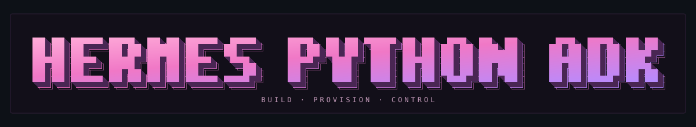

<p align="center">
  
</p>

<p align="center">
  <strong>Build agents. Provision Hermes instances. Control them from Python.</strong>
</p>

<p align="center">
  <a href="pyproject.toml"></a>
  <a href="docs/convenience-api.md"></a>
  <a href="contracts/openapi"></a>
  <a href=".github/workflows/ci.yml"></a>
  <a href="docs/verification-2026-09-25.md"></a>
</p>

<p align="center">
  <a href="#quickstart">Quickstart</a> ·
  <a href="#connect-to-an-existing-instance">Existing instances</a> ·
  <a href="#choose-your-runtime">Runtimes</a> ·
  <a href="#documentation">Documentation</a>
</p>

Hermes Python ADK is the agent development kit in `edith-hermes-sdk`. Define named agents,
attach Python tools, create Hermes instances, and address a specific profile or conversation
through a typed, asynchronous API. Run the control plane inside your Python process or connect
to a deployed service.

The package and imports remain `edith-hermes-sdk` and `edith_hermes`. This is an independent
project built around [Nous Research's Hermes Agent](https://github.com/NousResearch/hermes-agent).
The convenience API shown here lives in the **unreleased working tree**; install from this checkout.

## Quickstart

Use Python 3.10–3.13 and a running Docker-compatible engine for this example.
From the root of this working checkout:

```bash
python -m pip install -e ".[control-plane,streaming]"
```

Create one container with two profiles and different tools:

```python
import asyncio

from edith_hermes import Agent, Docker, Hermes, tool


@tool
def celsius_to_fahrenheit(celsius: float) -> dict[str, float]:
    """Convert Celsius to Fahrenheit."""
    return {"fahrenheit": celsius * 1.8 + 32}


@tool
def multiply(a: int, b: int) -> dict[str, int]:
    """Multiply two integers."""
    return {"product": a * b}


async def main():
    async with Hermes.local(runtime=Docker()) as hermes:
        instance = await hermes.create_instance(
            "personal-assistants",
            agents=[
                Agent("Adam", instructions="Help Adam with temperatures.",
                      tools=[celsius_to_fahrenheit]),
                Agent("Anas", instructions="Help Anas with calculations.",
                      tools=[multiply]),
            ],
        )

        adam = instance.agent("Adam")
        session_id = await adam.new_session(title="Adam's first conversation")
        servers = await adam.native.mcp.servers.list()
        print(instance.id, adam.profile_id, session_id)
        print(servers)


asyncio.run(main())
```

This provisions the instance and registers tools without needing model credentials.
`Hermes.local()` uses SQLite metadata and starts the callback host for Python tools.
Docker does not require Kubernetes, PostgreSQL, OIDC or KMS.

Instances created in this context are deleted when it exits. Use
`Hermes.local(runtime=Docker(), cleanup=False)` to retain them, then reconnect with
`await hermes.open_instance(instance_id)` using the same state database. Keep the callback host
running while agents need its Python tools.

### Configure a model and run an agent

Pass a `Model` to the agent when creating its profile. For an OpenAI-compatible provider:

```python
import os

from edith_hermes import Agent, Model

model = Model(
    id=os.environ["HERMES_MODEL"],
    provider="custom",
    base_url=os.environ["HERMES_MODEL_BASE_URL"],
    api_key=os.environ["HERMES_MODEL_API_KEY"],
)
adam_config = Agent("Adam", model=model, instructions="Be concise.")
# Supply adam_config to create_instance(..., agents=[adam_config]).
```

The model endpoint must be reachable from the Hermes runtime. After provisioning a profile
with a supported model, invoke it through its bound handle:

```python
adam = instance.agent("Adam")
result = await adam.run("Explain your role and available tools.", timeout=180)
print(result.status, result.text)
```

`run()` waits for a result. For explicit control over a running turn:

```python
turn = await adam.start("Investigate this task.")
await turn.steer("Focus on the Python implementation.")
result = await turn.wait(timeout=180)
# await turn.stop()
```

See [verification status](#verification-status) for the current local-model tool-execution failure.

## Connect to an existing instance

Connect to the **control-plane API**, then select an instance and its profile:

```python
import os

from edith_hermes import Hermes

async with Hermes.remote(
    base_url=os.environ["HERMES_CONTROL_PLANE_URL"],
    token=os.getenv("HERMES_CONTROL_PLANE_TOKEN"),
) as hermes:
    instance = await hermes.open_instance(os.environ["HERMES_INSTANCE_ID"])
    anas = instance.agent("Anas")
    result = await anas.run("Explain your configuration and what you can do.")
    print(result.text)
```

The selected profile needs a configured model. The control plane may run locally or remotely;
its URL differs from the model-provider URL and a native Hermes WebSocket endpoint.
Closing a remote client leaves its instances running. Remote Python tools require a reachable
`ToolHost`; see the [callback-host setup](docs/convenience-api.md#remote-python-tools).

## Choose your runtime

Runtime selection controls where Hermes executes. State, authentication and image policy
are separate settings.

| Python configuration | What it targets |
| --- | --- |
| `Docker(image="nousresearch/hermes-agent:latest")` | A dedicated Docker-compatible container |
| `Process(executable="hermes")` | A locally installed Hermes process with its own data home |
| `Kubernetes(image="your-hermes-image", namespace="hermes-runtimes")` | A Kubernetes workload managed by a cluster-connected control plane |
| `External(endpoint="wss://hermes.example/api/ws")` | An existing Hermes endpoint whose lifecycle you manage separately |
| A configured `nous_cloud` adapter | Provisioning through an application-supplied cloud adapter |

Choose the provider on `Hermes.local(runtime=...)` or override it per
`create_instance(..., runtime=...)` when the control plane enables that provider.
For Kubernetes deployment and bridge configuration, see the
[control-plane guide](deploy/control-plane/README.md).

SQLite is the lightweight state backend; PostgreSQL is available for shared durable jobs.
Authentication may be anonymous, static bearer tokens, or OIDC. Scanning and signing are optional
policies. See [configuration](docs/configuration.md) for the supported combinations.

## Address the exact target

```text
Hermes control plane
  +-- instance
  |     +-- profile (Adam / Anas / ...)
  |           +-- session
  |                 +-- turn
  +-- pool --> instance leases
  +-- images, tools, jobs
```

Profiles hold separate configuration and conversation state inside one instance. Use separate
instances when untrusted users need process or container isolation.

| Task | Python surface |
| --- | --- |
| Provision or reopen an instance | `hermes.create_instance(...)`, `hermes.open_instance(id)` |
| Select a known instance/profile | `hermes.instances(id).profiles(profile_id)` |
| Operate on a named agent | `instance.agent("Adam")` |
| Manage conversations and turns | `agent.sessions(id).turns(turn_id)` |
| Manage capacity and allocation | `hermes.pools`, `hermes.pools(id).leases` |
| Build and manage images | `hermes.images.recipes`, `hermes.images.builds`, `hermes.images` |
| Manage tool registration | `hermes.tools.bundles`, `hermes.tools.bindings`, `hermes.tools.mcp_servers` |
| Access native Hermes methods | `agent.native`, for example `agent.native.mcp.servers.list()` |

The typed resource surface covers the **64 HTTP operations and 219 native RPC methods** in
the checked-in contracts. Native behavior follows the pinned upstream gateway contract.
`agent.connect()` provides a persistent native connection for events and explicit server-request
replies; [`gateway.md`](contracts/websocket/gateway.md) describes the protocol.

The original `AsyncEdithHermes` / `EdithHermes` clients remain available, including
`sdk.control_plane`, `sdk.runtime`, `sdk.tools`, `sdk.images`, `sdk.gateway` and `sdk.inference`.
See the [API reference](docs/convenience-api.md) for typed signatures and extension points.

## Verification status

The [September 25 verification report](docs/verification-2026-09-25.md) records **338 passing
tests**, live Docker and Kubernetes lifecycle checks, a real Hermes process test inside Linux,
and PostgreSQL storage/concurrent job-claim checks. Generation coverage is separate from live
verification of individual methods.

The tested local `gemma3-tools:12b` model discovered the registered tool but emitted tool-call
text without invoking the Python callback. End-to-end model-selected tool execution is still
unresolved. External OAuth/OIDC/KMS, registry scanning/signing, cloud-provider deployments and
multi-node operation have not been verified live.

Current adapters support **profile-scoped** tool bindings. Per-turn/session tool isolation,
per-session environment overrides, branching by SDK `fromTurnId`, and MCP secret-reference/native
allow-list reconciliation are not implemented. Complete typed cloud management still needs an
authoritative provider contract and adapter. The report gives the exact boundaries.

## Documentation

| Guide | Contents |
| --- | --- |
| [Convenience API](docs/convenience-api.md) | Resources, native methods, typing, callbacks and completeness boundaries |
| [Configuration](docs/configuration.md) | Runtime, database, authentication, secrets and image-policy choices |
| [Verification report](docs/verification-2026-09-25.md) | Recorded live results, fixes and outstanding issues |
| [Local demos](docs/local-verification.md) | Docker/Kubernetes demonstrations and earlier evidence |
| [Control-plane deployment](deploy/control-plane/README.md) | FastAPI service, workers and production blueprint |
| [Kubernetes pools](deploy/kubernetes/README.md) | Workload layout, networking and persistent storage |
| [Source map](contracts/sources.yaml) | Pinned upstream contracts and SDK coverage |
| [OpenAPI contracts](contracts/openapi) | Instances/profiles/pools, runtime sessions/turns, tools and images |

## Development

```bash
uv sync --all-extras --group dev
uv run pytest
uv run ruff check .
uv run mypy src/edith_hermes
uv run python scripts/validate_contracts.py
uv run python scripts/generate_sdk.py
uv build
```

Runnable lifecycle demo: `uv run python examples/agents_docker.py --restart`.
Opt-in live checks are in `scripts/verify_*_live.py` and `scripts/verify_live.py`;
read their runtime requirements before running them.

The [SVG banner](assets/branding/hermes-python-adk.svg),
[plain ASCII](assets/branding/hermes-python-adk.txt) and
[ANSI color version](assets/branding/hermes-python-adk.ansi) share original pixel glyphs.
Regenerate them with `uv run python scripts/generate_branding.py`.
Badges use [Shields.io](https://shields.io/docs/static-badges); the CI badge links to the
workflow configuration and does not assert a passing build.
